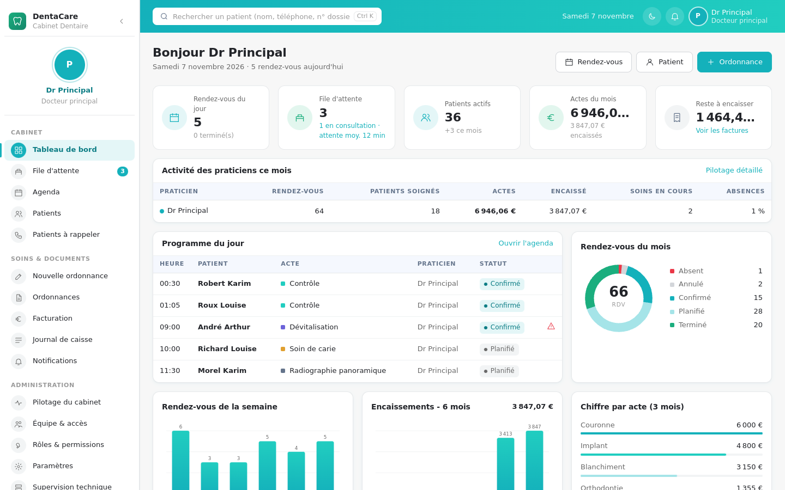
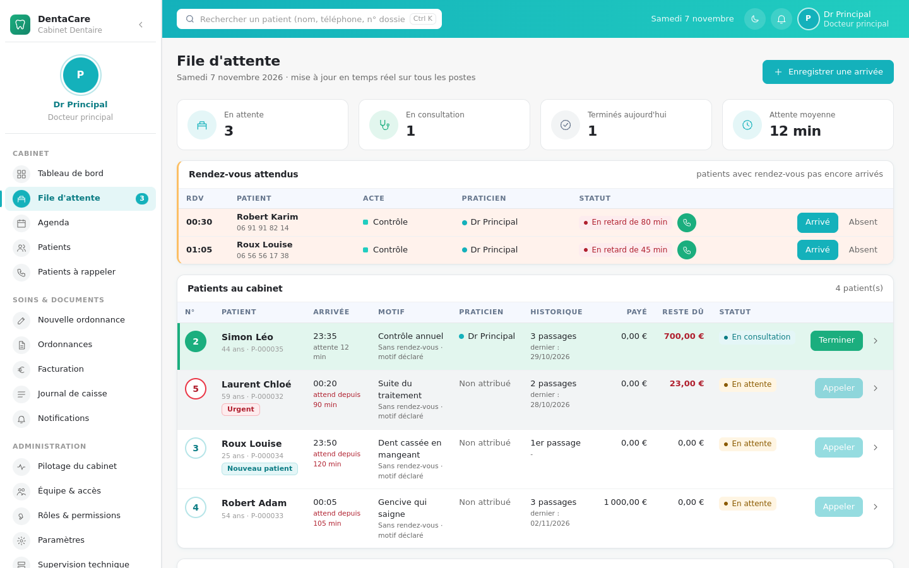
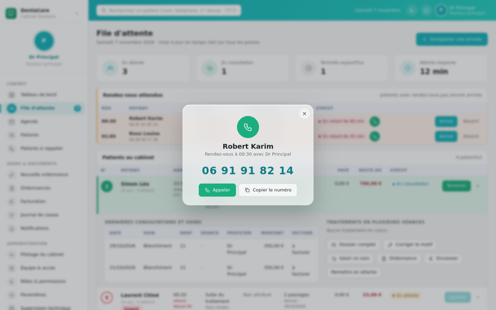
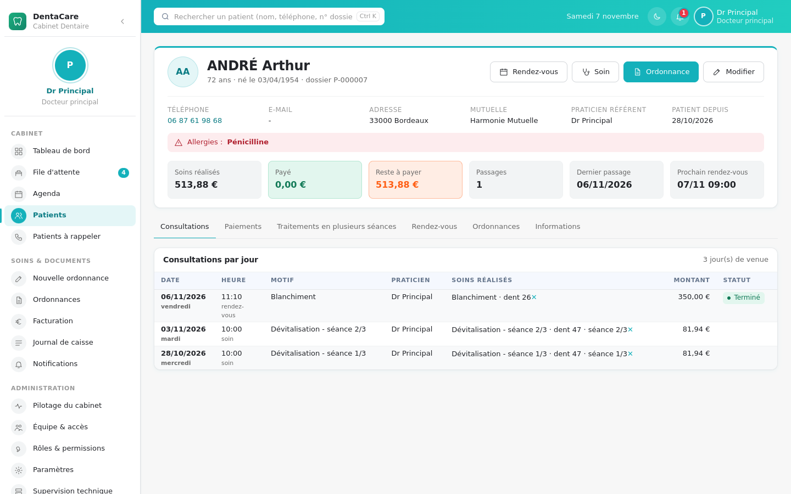
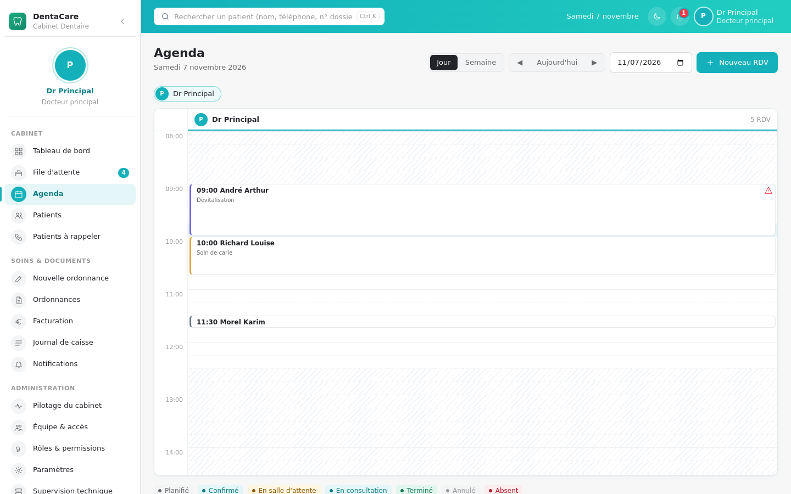
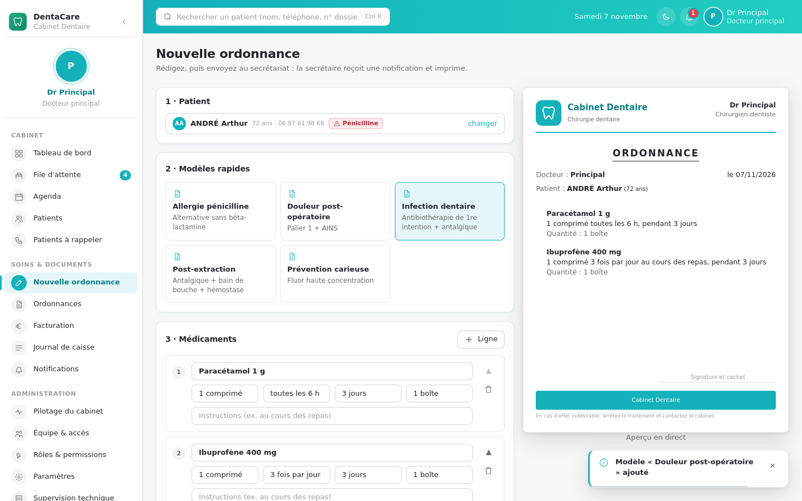
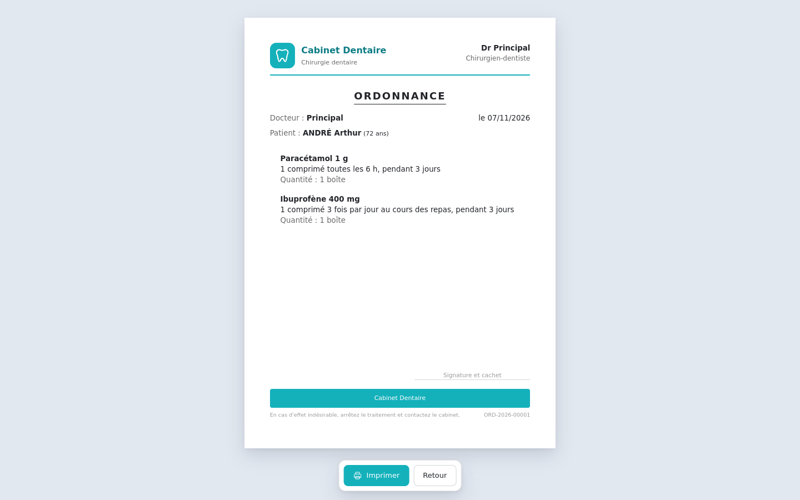
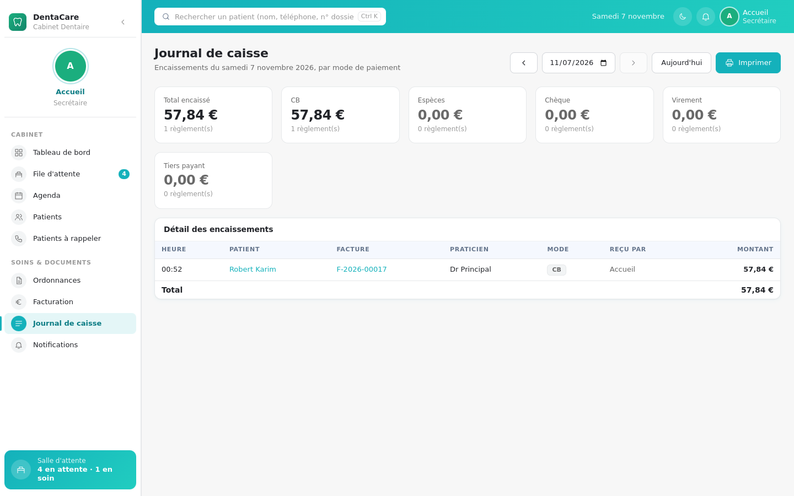
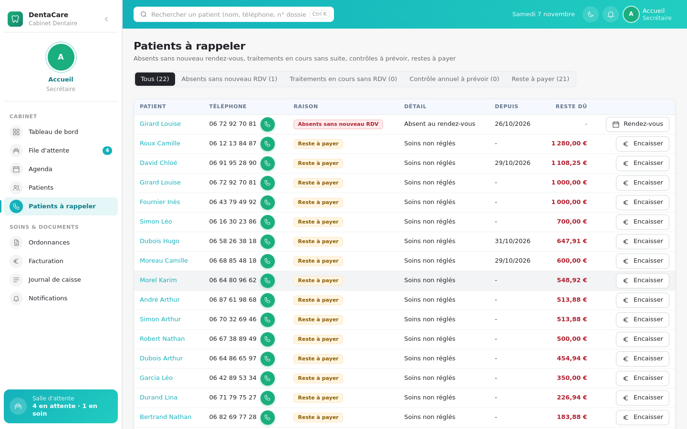

# DentaCare

Logiciel de gestion de cabinet dentaire, **hors ligne**, pour un cabinet en réseau local : un poste serveur garde les données, les autres postes (docteurs, secrétaires) s'y connectent.

Projet d'apprentissage : React + TypeScript, Node.js, SQLite, Electron.



---

## Sommaire

1. [Fonctionnalités](#fonctionnalités)
2. [Profils et droits](#profils-et-droits)
3. [Captures d'écran](#captures-décran)
4. [Architecture technique](#architecture-technique)
5. [Installation](#installation)
6. [Utilisation au cabinet](#utilisation-au-cabinet)
7. [Commandes utiles](#commandes-utiles)
8. [Structure du projet](#structure-du-projet)
9. [Sécurité et données](#sécurité-et-données)
10. [Dépannage](#dépannage)

---

## Fonctionnalités

### File d'attente (salle d'attente)
- Enregistrement d'une arrivée : patient déjà suivi (aucune ressaisie) ou nouveau patient (dossier minimal créé en une étape).
- Numéro de passage du jour, tableau mis à jour **en temps réel sur tous les postes**, patient en cours surligné en vert.
- Ordre de passage : urgences d'abord, puis **patients avec rendez-vous dès que leur heure arrive**, puis ordre d'arrivée.
- « Rendez-vous attendus » : patients en retard ou attendus dans les 30 minutes, avec un bouton téléphone vert qui ouvre une fenêtre d'appel (numéro, appeler, copier).
- Motif déclaré à l'accueil, corrigé ensuite par le praticien (diagnostic).
- N'importe quel docteur peut prendre en charge n'importe quel patient.

### Agenda
- Vue jour (une colonne par praticien) et vue semaine, au quart d'heure.
- Contrôle des règles en direct : horaires d'ouverture, chevauchements praticien et patient, durée, dates passées, urgences hors horaires.
- Créneaux libres proposés automatiquement.
- Statuts : planifié, confirmé, arrivé, en consultation, terminé, annulé (motif, annulation tardive), absent.

### Dossier patient
- Informations en haut : coordonnées, mutuelle, praticien référent, allergies bien visibles.
- Indicateurs : soins réalisés, payé, reste à payer, passages, dernier passage, prochain rendez-vous.
- Consultations **par jour avec l'heure exacte d'arrivée**, motif, praticien, soins réalisés.
- Paiements par date et détail du reste à payer.
- Traitements en plusieurs séances (ex. dévitalisation de la 36 en 3 séances) avec suivi d'avancement.
- Archivage, anonymisation RGPD.

### Ordonnances
- Rédaction avec catalogue de médicaments, modèles rapides, aperçu en direct.
- Alerte allergie (ex. pénicilline + amoxicilline).
- Envoi au secrétariat : **notification instantanée** chez la secrétaire, file d'impression, impression automatique possible.
- Mise en page : en-tête du cabinet, titre ORDONNANCE, praticien, lieu et date, pied de page avec coordonnées.
- Suivi : rédigée → envoyée → imprimée → remise ; renouvellement en un clic.

### Facturation et caisse
- Soins à facturer regroupés par patient, création de facture, encaissement (CB, espèces, chèque, virement, tiers payant), règlements partiels.
- **Journal de caisse** du jour par mode de paiement, imprimable.
- **Patients à rappeler** : absents sans nouveau rendez-vous, traitements en cours sans rendez-vous, contrôle à prévoir, restes à payer.

### Pilotage et administration
- Tableau de bord adapté au profil, indicateurs par praticien (actes, encaissements, absences, attente moyenne).
- Comptes créés uniquement par le docteur principal, rôles et permissions configurables.
- Paramètres du cabinet (horaires, tarifs, médicaments, modèles), mode maintenance, données de démonstration.
- Supervision technique en temps réel, journaux, journal d'audit, sauvegardes quotidiennes.

---

## Profils et droits

| Profil | Rôle |
|---|---|
| **Docteur principal** | Administrateur : crée les comptes, règle les permissions et les paramètres. Possède tous les droits. |
| **Docteur** | Soins, ordonnances, consultations, diagnostic, ses indicateurs. |
| **Secrétaire** | Accueil, file d'attente, agenda, dossiers administratifs, facturation, impression des ordonnances. Ne peut jamais prescrire ni voir les antécédents médicaux. |

Les permissions des docteurs et des secrétaires se règlent dans **Administration → Rôles & permissions**. Les droits sont vérifiés côté serveur : masquer un bouton ne suffit pas à contourner un refus.

---

## Captures d'écran

| File d'attente | Fenêtre d'appel |
|---|---|
|  |  |
| **Dossier patient** | **Agenda** |
|  |  |
| **Saisie d'ordonnance** | **Ordonnance imprimée** |
|  |  |
| **Journal de caisse** | **Patients à rappeler** |
|  |  |

---

## Architecture technique

```
 Poste serveur                                   Autres postes du réseau local
┌──────────────────────────────────────┐        ┌──────────────────────────┐
│ Electron (fenêtre)                   │        │ Electron (mode client)   │
│   └─ Serveur Node.js / Express :5080 │◄──────►│ ou navigateur web        │
│        ├─ API REST (/api)            │  HTTP  │ http://IP-SERVEUR:5080   │
│        ├─ Temps réel (SSE)           │        └──────────────────────────┘
│        ├─ Interface React (fichiers) │
│        └─ SQLite (sql.js) → fichier  │
└──────────────────────────────────────┘
```

| Couche | Choix | Pourquoi |
|---|---|---|
| Interface | React 19 + TypeScript, Vite | Composants, typage, construction rapide |
| Styles | CSS maison (`tokens.css` + `app.css`) | Aucune dépendance, thème clair et sombre |
| Serveur | Node.js 22 + Express 5 | Une seule langue (TypeScript) de bout en bout |
| Temps réel | Server-Sent Events | File d'attente, notifications et ordonnances instantanées, sans bibliothèque |
| Base | SQLite via sql.js (WebAssembly) | Un seul fichier, rien à compiler à l'installation |
| Bureau | Electron | Application Windows, impression silencieuse des ordonnances |
| Règles partagées | Dossier `shared/` | Mêmes règles (statuts, permissions, validation d'ordonnance) côté serveur et interface |

---

## Installation

### Prérequis
- **Node.js 22** (22.23.4 ou plus récent) : https://nodejs.org
- Git
- Windows 10/11 (fonctionne aussi sous macOS et Linux)
- Environ **2 Go libres** sur le disque

### Récupérer le projet

```bash
git clone https://github.com/VOTRE-COMPTE/dentacare.git
cd dentacare
npm install
```

### Lancer dans le navigateur (le plus simple)

```bash
npm run build
npm run serve
```

Ouvrir **http://localhost:5080**.

### Lancer l'application de bureau (Electron)

```bash
npm start
```

Au premier lancement, choisir **Poste serveur** (ou **Poste client** avec l'adresse du serveur, ex. `http://192.168.1.10:5080`).

### Premiers identifiants

Au tout premier démarrage, deux comptes sont créés :

- `docteur` : docteur principal (administrateur) ;
- `secretaire` : secrétaire.

Leurs **mots de passe temporaires** s'affichent une seule fois dans la console et dans le fichier `identifiants-initiaux.txt` du dossier de données. Chacun choisit son mot de passe à la première connexion, puis le fichier est supprimé.

Pour tester avec des données fictives : **Paramètres → Système → Charger la démo**.

---

## Utilisation au cabinet

1. Installer DentaCare sur le **poste serveur** (un PC qui reste allumé pendant les heures d'ouverture).
2. Lancer DentaCare en mode **Poste serveur**. Au premier lancement, le pare-feu Windows demande l'autorisation : n'autoriser que les **réseaux privés**.
3. Noter l'adresse affichée dans **Administration → Supervision** (« Adresses pour les autres postes »).
4. Sur chaque autre poste : DentaCare en mode **Poste client** avec cette adresse, ou un navigateur sur cette adresse.
5. Le docteur principal crée les comptes dans **Équipe & accès**.

Dossier de données :

| Lancement | Dossier |
|---|---|
| Application de bureau | `%APPDATA%\DentaCare\data` |
| `npm run serve` | `app-data` dans le dossier du projet |

Variables d'environnement facultatives : `DENTACARE_DATA` (dossier), `DENTACARE_PORT` (port, 5080 par défaut), `DENTACARE_HOST` (interface d'écoute).

---

## Commandes utiles

| Commande | Effet |
|---|---|
| `npm run build` | Construit l'interface et le serveur dans `dist/` |
| `npm run serve` | Lance le serveur (interface sur http://localhost:5080) |
| `npm start` | Construit puis ouvre l'application Electron |
| `npm run selftest` | Auto-test des règles de gestion (51 contrôles) |
| `npm run reset-password -- docteur` | Nouveau mot de passe temporaire (application arrêtée, sur le poste serveur) |
| `npm run typecheck` | Vérification TypeScript |
| `npm run dist` | Installateur Windows dans `release/` |

---

## Structure du projet

```
electron/          Processus principal Electron, préchargement, écran « serveur ou client »
server/src/
  db/              Accès SQLite, schéma versionné et données de référence
  security/        Mots de passe (bcrypt), sessions, permissions, audit, comptes initiaux
  services/        Règles métier : patients, agenda, file d'attente, soins, facturation, ordonnances, statistiques
  routes/          API REST
  obs/             Journaux, métriques, événements temps réel
  index.ts         Démarrage du serveur, --selftest, --reset-password
shared/            Règles et libellés communs au serveur et à l'interface
web/src/
  pages/           Un fichier par écran (pages/admin, pages/print)
  components/      Composants réutilisables (fenêtres, graphiques, ordonnance, sélecteur de patient…)
  lib/             Client API, session, temps réel, formats, impression
  styles/          tokens.css (couleurs, espacements) + app.css
scripts/           Construction du serveur et d'Electron (esbuild)
docs/captures/     Captures d'écran
```

---

## Sécurité et données

- Mots de passe hachés avec **bcrypt** (coût 12) ; 10 caractères minimum avec majuscule, minuscule et chiffre.
- Verrouillage 15 minutes après 5 échecs de connexion.
- Session par cookie **HttpOnly + SameSite=Strict**, révoquée au changement de mot de passe, de profil ou à la désactivation du compte.
- Protection CSRF (en-tête obligatoire sur les requêtes qui modifient).
- Requêtes SQL toujours paramétrées ; entrées validées côté serveur.
- Aucune donnée patient ni secret dans les journaux techniques ; journal d'audit de toutes les actions.
- Aucune ressource externe, aucun démarrage automatique, aucun droit administrateur requis.
- Sauvegarde quotidienne automatique dans `data\backups` : à copier régulièrement sur un support externe chiffré.

> DentaCare traite des données de santé. Les données réelles ne doivent jamais être versionnées : `app-data/`, `*.db` et `identifiants-initiaux.txt` sont exclus par `.gitignore`.

---

## Dépannage

| Problème | Solution |
|---|---|
| `ENOSPC: no space left on device` | Disque plein : libérer au moins 2 Go, supprimer `node_modules`, relancer `npm install`. |
| `Cannot find module @rollup/rollup-win32-x64-msvc` | Supprimer `node_modules` et `package-lock.json`, puis `npm install`. |
| `Electron failed to install correctly` / `fetch failed` | Le réseau bloque le téléchargement d'Electron (proxy d'entreprise). Utiliser `npm run serve` dans le navigateur, ou obtenir Electron depuis une source approuvée et définir `ELECTRON_OVERRIDE_DIST_PATH`. |
| `'vite' is not recognized` | Installation incomplète : relancer `npm install`. |
| Mot de passe oublié | `npm run reset-password -- docteur` sur le poste serveur, application arrêtée. |
| Les autres postes n'accèdent pas au serveur | Vérifier l'adresse IP, le port 5080 et l'autorisation du pare-feu (réseau privé). |

---

## Licence

Projet personnel d'apprentissage. Tous droits réservés.
